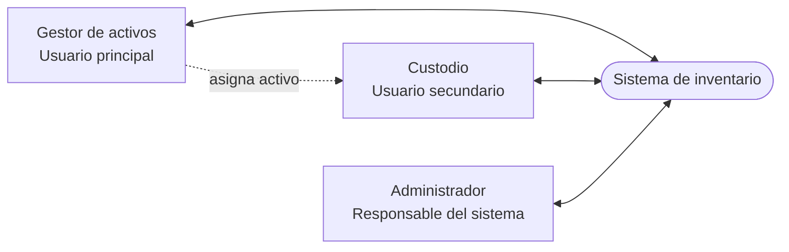

# Mapa de actores

Mapa de actores del sistema de inventario y sus relaciones. Línea continua: interacción con el sistema; línea discontinua: relación entre actores. Descripción detallada en [actores.md](actores.md).

