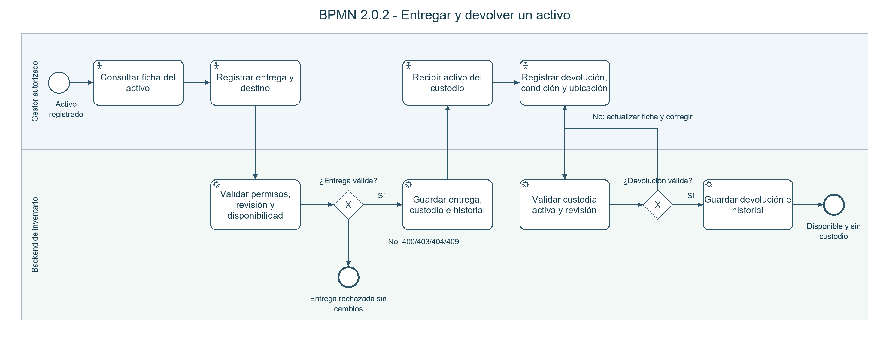
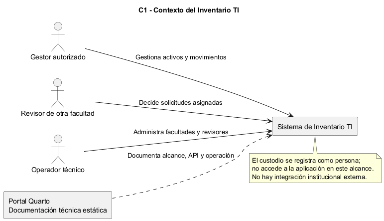
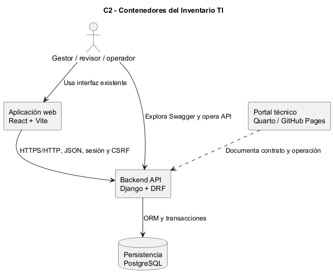
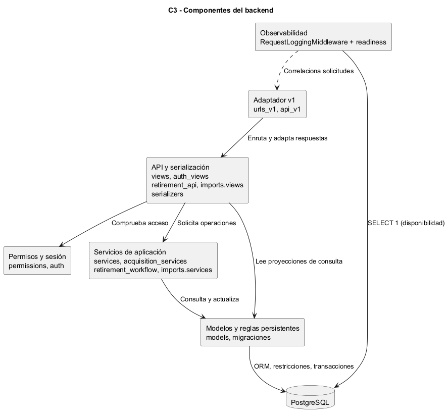
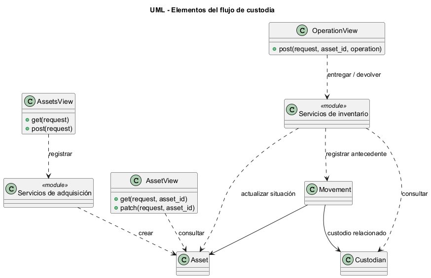

# 1. Contexto, propósito y alcance

Consolidamos el backend de la Unidad 1 a partir de develop b60f52f. El proyecto corresponde al tema 2 del banco de proyectos de la asignatura. La propuesta parte del enunciado y acuerdos documentados, sin afirmar entrevistas o procedimientos institucionales no investigados. Buscamos demostrar correspondencia entre requisito, contrato HTTP, validación, regla de negocio, persistencia, respuesta y prueba.

Consolidamos el backend de Unidad 1 para registrar activos/adquisiciones, controlar custodia y conservar trazabilidad de novedades, mantenimiento y bajas. El portal reúne especificaciones, decisiones, contratos y comprobaciones del incremento.

## Problema y objetivo

Un inventario disperso dificulta conocer qué equipo existe, dónde está, quién lo recibió y qué ocurrió durante su vida útil. Buscamos mantener registros coherentes y auditables mediante una API autenticada, evitando cambios contradictorios y preservando antecedentes.

## Alcance delimitado

| Módulo | Resultado |
|---|---|
| Acceso | Cuentas individuales, sesión de 30 minutos, CSRF, permisos y límite de intentos. |
| Activos/adquisición | Código TI, facultad, factura/respaldo compartido, valor individual y edición auditada. |
| Custodia | Personas sin cuenta, entrega/devolución, condición y rectificación del último movimiento elegible. |
| Ciclo de vida | Alertas; pérdida/robo, recuperación, mantenimiento iniciado/cerrado e historial. |
| Bajas | Normal desde Disponible; revisión independiente de otra facultad para No localizado. |
| Licencias | Lotes finitos por usuario/dispositivo, cantidades/vigencia/remanentes; sin claves. |
| QR | Enlace interno sin datos personales; ficha protegida tras autenticación. |
| CSV | Plantillas, validación integral, dos confirmaciones del creador y aplicación atómica. |

Sin integración institucional, traslado independiente, licencias ilimitadas, asignaciones individuales de licencias ni frontend nuevo para todo el backend. La interfaz existente y Swagger tienen propósitos distintos; la demostración usa API real.

## Actores

| Actor | Acceso |
|---|---|
| Gestor | Opera inventario y solicita bajas; conserva autoría. |
| Revisor | Cambia contraseña temporal y decide solicitudes asignadas; otra facultad. |
| Operador | Administra facultades/revisores, reasigna y cambia facultad con controles. |
| Custodio | Persona con nombre/correo; participa físicamente, sin inicio de sesión. |

Gestores y operador se provisionan por comando local; revisores desde administración del operador. Sin auto-registro.


[Repositorio](https://github.com/SteveJ4ra/inventario-TI-unl/tree/develop). Quarto queda preparado para Pages; la dirección configurada se activa tras revisión/publicación, y no es un backend público.

# 2. Especificación y trazabilidad

## Enfoque SDD

Partimos del problema y de decisiones confirmadas, describimos comportamientos/aceptación, planificamos componentes, descomponemos tareas, implementamos y validamos. Clarificar resuelve ambigüedades antes de convertirlas en reglas; analizar contrasta especificación, plan, tareas y código. Implementar es trabajo verificable, no solo crear un archivo. La validación registra resultados reales.

La [constitución](recursos/constitution.md) conserva el estado PROPOSAL de su fuente; no atribuimos una ratificación humana que no consta. Las decisiones funcionales confirmadas y los contratos por módulo son las referencias del incremento. No se reconstruyen las semanas previas.

## Especificaciones canónicas

| ID | Alcance | Fuentes |
|---|---|---|
| 002 | Activos y custodia | [Especificar/clarificar](recursos/specs/002-registro-consulta-activos/spec.md), [Plan](recursos/specs/002-registro-consulta-activos/plan.md), [Tareas](recursos/specs/002-registro-consulta-activos/tasks.md), [Validación](recursos/specs/002-registro-consulta-activos/validation.md) |
| 003 | Fichas/adquisiciones | [Especificar/clarificar](recursos/specs/003-fichas-adquisiciones/spec.md), [Plan](recursos/specs/003-fichas-adquisiciones/plan.md), [Tareas](recursos/specs/003-fichas-adquisiciones/tasks.md), [Implementación](recursos/specs/003-fichas-adquisiciones/implementation.md), [Validación](recursos/specs/003-fichas-adquisiciones/validation.md) |
| 004 | Novedades/mantenimiento | [Especificar/clarificar](recursos/specs/004-novedades-mantenimiento/spec.md), [Plan](recursos/specs/004-novedades-mantenimiento/plan.md), [Tareas](recursos/specs/004-novedades-mantenimiento/tasks.md), [Implementación](recursos/specs/004-novedades-mantenimiento/implementation.md), [Validación](recursos/specs/004-novedades-mantenimiento/validation.md) |
| 005 | Bajas/aprobación | [Especificar/clarificar](recursos/specs/005-bajas-aprobacion/spec.md), [Plan](recursos/specs/005-bajas-aprobacion/plan.md), [Tareas](recursos/specs/005-bajas-aprobacion/tasks.md), [Implementación](recursos/specs/005-bajas-aprobacion/implementation.md), [Validación](recursos/specs/005-bajas-aprobacion/validation.md) |
| 006 | Lotes de licencias | [Especificar/clarificar](recursos/specs/006-lotes-licencias/spec.md), [Plan](recursos/specs/006-lotes-licencias/plan.md), [Tareas](recursos/specs/006-lotes-licencias/tasks.md), [Implementación](recursos/specs/006-lotes-licencias/implementation.md), [Validación](recursos/specs/006-lotes-licencias/validation.md) |
| 007 | QR | [Especificar/clarificar](recursos/specs/007-qr-activos/spec.md), [Plan](recursos/specs/007-qr-activos/plan.md), [Tareas](recursos/specs/007-qr-activos/tasks.md), [Implementación](recursos/specs/007-qr-activos/implementation.md), [Validación](recursos/specs/007-qr-activos/validation.md) |
| 008 | Importación CSV | [Especificar/clarificar](recursos/specs/008-importacion-csv/spec.md), [Plan](recursos/specs/008-importacion-csv/plan.md), [Tareas](recursos/specs/008-importacion-csv/tasks.md), [Implementación](recursos/specs/008-importacion-csv/implementation.md), [Validación](recursos/specs/008-importacion-csv/validation.md) |
| 009 | Consolidación técnica | [Especificar/clarificar](recursos/specs/009-consolidacion-final/spec.md), [Plan](recursos/specs/009-consolidacion-final/plan.md), [Tareas](recursos/specs/009-consolidacion-final/tasks.md), [Implementación](recursos/specs/009-consolidacion-final/implementation.md), [Validación](recursos/specs/009-consolidacion-final/validation.md) |

## Historias y aceptación del backend

| Referencia | Historia de usuario | Criterio representativo: Dado / Cuando / Entonces |
|---|---|---|
| 002 / Historia 1 (P1) | Como gestor autorizado, quiero registrar los datos de un equipo y recibir su código para distinguirlo individualmente. | Dada facultad/adquisición válidas y campos obligatorios, cuando registro el activo, entonces recibe código TI estable y queda Disponible/sin custodio. |
| 002 / Historia 2 (P1) | Como gestor, quiero registrar entrega y devolución para conocer la custodia y conservar trazabilidad. | Dado un activo Operativo/Disponible sin mantenimiento, cuando lo entrego con revisión vigente, entonces conserva custodio/destino/autor; al devolverlo con condición/recepción queda sin custodio. |
| 002 / Historia 3 (P2) | Como gestor, quiero rectificar el último error elegible para conservar el antecedente y corregir la situación actual. | Dado el último movimiento rectificable, cuando indico motivo/revisión, entonces restaura el estado previo y vincula la rectificación sin borrar el original. |
| 003 / US1-US2 (P1) | Como gestor, quiero asociar factura o respaldo compartido a equipos para conservar documento común y valor individual. | Dada una compra con factura o donación con respaldo válidos, cuando registro sus líneas, entonces cada activo conserva su valor y el vínculo documental común. |
| 003 / US3 (P1) | Como gestor, quiero corregir datos descriptivos para conservar información exacta y quién cambió qué. | Dada la revisión/instantánea vigente, cuando corrijo con motivo, entonces guarda antes/después y autor sin alterar movimientos antiguos. |
| 004 / US1 (P1) | Como gestor, quiero registrar una novedad para señalar un daño u observación pendiente de atención. | Dado un daño, cuando registro la novedad, entonces conserva condición y alerta; al resolver con nota conserva fecha/gestor/historial. |
| 004 / US2 (P1) | Como gestor, quiero registrar envío al taller y resultado para controlar la intervención real del equipo. | Dado un activo disponible, cuando inicio mantenimiento, entonces bloquea entrega; al cerrar exige resultado y ubicación confirmada. |
| 004 / US3 (P1) | Como gestor, quiero reportar pérdida/robo y recuperación para conservar referencias del último estado conocido. | Dado un activo localizado, cuando reporto pérdida/robo, entonces pasa a No localizado sin devolución ficticia; recuperar exige inspección. |
| 005 / US1-US2 (P1) | Como gestor, quiero registrar una baja justificada y separar la decisión de otra facultad cuando el activo no está localizado. | Dado Disponible y sin mantenimiento, la baja normal conserva motivo/autor; dado No localizado, solo el revisor asignado de otra facultad decide. |
| 005 / US3 (P1) | Como operador, quiero administrar revisores y su facultad para mantener revisión individual e independiente. | Dado un revisor con solicitudes pendientes, cuando intento desactivarlo, entonces lo impide hasta reasignarlas; conserva auditoría y exige cambio de contraseña inicial. |
| 006 / US1-US2 (P1) | Como gestor, quiero registrar lotes y ajustar uso agregado para conocer cantidades y conservar su evolución. | Dado un lote de diez puestos con cuatro en uso, cuando vence, entonces muestra seis remanentes y Vencido; rechaza uso mayor que lo comprado. |
| 007 / US1-US2 (P1) | Como gestor, quiero descargar/escanear el QR para identificar el equipo y abrir su ficha protegida. | Dado un activo, cuando descargo el SVG, entonces contiene enlace sin datos personales; la consulta de ficha exige sesión de gestor. |
| 008 / US1-US3 (P1) | Como gestor, quiero importar activos/licencias con vista previa para evitar carga parcial o accidental. | Dado un lote con una fila inválida, no crea registros; dado uno válido, solo el creador confirma dos veces su hash y se revalida antes de aplicar todo atómicamente. |

Las historias anteriores resumen las especificaciones enlazadas; no sustituyen sus escenarios detallados ni asignan nuevas funcionalidades.


## Matriz del backend

La matriz conserva 104 requisitos: 23 de 002, 16 de 003, 16 de 004, 17 de 005, 12 de 006, ocho de 007 y 12 de 008. Cada fila enlaza fuente, componentes y prueba. 009 agrega seis requisitos técnicos. No es un porcentaje de cobertura de líneas; las referencias históricas a interfaz se distinguen del alcance backend. La matriz íntegra está en el portal y en docs/semana-5/matriz-trazabilidad.md.

| RNF | Criterio y evidencia |
|---|---|
| RNF-01: acceso | Permisos por rol/objeto; sin lectura de solicitudes ajenas. |
| RNF-02: integridad | Rechazos y lotes fallidos sin escrituras parciales; concurrencia/rollback. |
| RNF-03: auditabilidad | Autor, fecha y antecedentes; historial/instantáneas/rectificaciones. |
| RNF-04: reproducibilidad | Preparación, migraciones y pruebas según instrucciones. |
| RNF-05: interoperabilidad | Contrato, códigos y cuerpos corresponden a ejecución; OpenAPI/respuestas reales. |


# 3. Proceso principal: análisis textual


## Análisis textual previo al diagrama

| Elemento | Definición |
|---|---|
| Propósito | Conservar quién entrega, quién recibe temporalmente, dónde está el activo y cómo regresa, sin sobrescribir antecedentes. |
| Participantes | Gestor autenticado y backend; el custodio participa físicamente, sin cuenta ni portal. |
| Inicio | Activo registrado con adquisición y facultad; código TI automático. |
| Entradas | Activo, revisión consultada, custodio y destino; al devolver: revisión, condición recibida y ubicación de recepción. |
| Datos | Asset, Custodian, Movement y sus instantáneas/autor; AcquisitionDocument y AcquisitionLine respaldan el alta. |
| Precondición de entrega | Localizado, Disponible, Operativo, sin mantenimiento activo; custodio existente y revisión vigente. |
| Precondición de devolución | Custodia activa y revisión vigente; una pérdida no produce una devolución ficticia. |
| Decisiones | Validar entrega y devolución; las salidas negativas no alteran el inventario. |
| Resultado | Entrega: Asignado con custodio/destino. Devolución: Disponible sin custodio, condición/recepción registradas. |
| Excepciones | 400 entrada; 403 acceso/CSRF; 404 recurso; 409 revisión/estado. Tras conflicto se consulta antes de corregir. |
| Límite | Sin reservas, solicitudes de préstamo, aprobación de entregas ni portal de custodios. |

## Secuencia operativa

1. Consultar la ficha y conservar su revisión.
2. Registrar la entrega con custodio y destino.
3. Validar permisos, revisión y disponibilidad en servidor.
4. Guardar entrega y movimiento en una transacción; si falla, rechazar sin cambios.
5. Recibir físicamente el activo y registrar devolución, condición y recepción.
6. Validar custodia y revisión; ante conflicto, consultar y corregir.
7. Guardar devolución e historial; dejar Disponible y sin custodio.

Las tareas usan infinitivo y complemento; los eventos describen situaciones; las compuertas exclusivas separan resultados mutuamente excluyentes. Las calles distinguen operación humana y backend. El XML incluye BPMN DI para importarlo en un modelador. isExecutable=false declara un modelo documental, no un motor de procesos.

## Vistas y correspondencia técnica

Vista ejecutiva: consultar -> entregar -> recibir -> devolver. Vista operativa: BPMN con validaciones y excepciones. Vista técnica: POST /api/v1/assets/{asset_id}/deliver/ y return/ -> OperationView -> DeliveryInput/ReturnInput -> services.record_operation -> transacción/bloqueo -> Asset/Movement. C4 y UML describen esa realización.

| Paso | Contrato/componente | Prueba o evidencia |
|---|---|---|
| Consultar | GET /assets/{asset_id}/; AssetView | VersionedFlowTests.test_asset_cycle_and_legacy_contract |
| Entregar | POST /deliver/; DeliveryInput; record_operation | Ciclo v1, movimientos, permisos y concurrencia |
| Guardar antecedente | Asset + Movement, transaction.atomic | Contratos de persistencia y pruebas de movimientos |
| Devolver | POST /return/; ReturnInput; record_operation | Ciclo v1 y rechazo de devolución sin custodia |
| Rechazar sin mutación | ValidationError, PermissionDenied, Conflict | Errores v1 y CSRF estricto |

## Relación con otros procesos

Daños/observaciones generan alerta sin cambiar automáticamente la condición. Pérdida/robo pasa a No localizado y conserva referencias. El mantenimiento bloquea entregas y se interrumpe si desaparece el activo. La baja normal exige Disponible y mantenimiento cerrado; No localizado requiere aprobación de otro revisor/facultad. Estos procesos conservan las reglas 004/005 y no son devoluciones silenciosas del BPMN.

<!-- landscape -->
# 4. BPMN operativo



XML BPMN 2.0.2 validado con XSD oficial OMG. El SVG ampliable y el archivo editable se incluyen en el portal.

<!-- portrait -->


# 5. Arquitectura y decisiones

## C1: contexto



## C2: contenedores



React/Vite es la interfaz existente, ejecutada aparte. Compose contiene Django/Gunicorn y PostgreSQL. Quarto es estático y no recibe credenciales ni almacena inventario. HTTP se limita al loopback; exposición externa requiere TLS/endurecimiento.

## C3: componentes



Vistas/serializadores comprueban entradas/permisos; servicios aplican reglas en transacciones; modelos/restricciones conservan integridad. V1 comparte esas capas. Observabilidad registra solicitudes sin copiar sus datos.

## C4/código: UML del flujo principal



Mostramos vistas, módulos de servicio y entidades participantes, no solo tablas. Los módulos adicionales se detallan en C3/especificaciones.

[Structurizr DSL](arquitectura.dsl), [PlantUML](uml-custodia.puml).

## Decisión de consolidación


**Estado:** implementación local conforme a respuestas de Steven del 06/11/2026. **Base:** develop b60f52f. **Ámbito:** consolidación de Unidad 1.

## Contexto

El backend integra 002-008. La API v1 de semana 3 cubría diez patrones del flujo principal; otros módulos usaban /api/. La evaluación requiere contrato uniforme, Quarto, BPMN y observabilidad. No se amplía el negocio.

## Decisión

1. Compartir vistas, permisos, serializadores y servicios en /api/v1/; conservar /api/ y sus representaciones. Incorporar en v1 la edición descriptiva auditada ya existente.
2. Construir OpenAPI 3.1 desde tipos DRF y un registro explícito de operaciones; probar cobertura exacta. Versión documental 1.1.0 por ampliación compatible.
3. Envolver JSON v1 con success/message/data/errors/meta. Documentar SVG/CSV y HEAD/204/304 como excepciones de protocolo/archivo.
4. Registrar request_id aleatorio, plantilla de ruta, método, estado y duración; excluir cuerpos, query strings, cookies y credenciales. Mantener auditoría de negocio en PostgreSQL.
5. Añadir /health/ready/ público con SELECT 1 y fallo 503 genérico. Docker lo usa sin publicar configuración ni datos.
6. Ejecutar pruebas con pytest/pytest-django en etapa Docker separada; conservar manage.py test y excluir dependencias de pruebas del runtime.
7. Generar Quarto estático y preparar Pages manual limitado a develop; publicar después de revisar. Pages no aloja Django/PostgreSQL.
8. Preparar CI de pruebas, migraciones, artefactos y portal; comprobar su ejecución remota después de subir, sin presentar pruebas locales como Actions ejecutado.

## Consecuencias y alternativas

Compartir adaptadores evita divergencias; derivar tipos reduce duplicación, pero las reglas entre campos y respuestas compuestas requieren anotación y pruebas. Crear otra API con reglas propias aumentaría inconsistencias.

Conservar sesión Django mantiene CSRF y expiración absoluta de treinta minutos. No añadimos JWT solo por llamar "tokenización" al requisito. La actualización visual existente continúa por sondeo cada cinco segundos, sin renovar sesión. Producción pública, métricas externas y WebSocket ampliarían el alcance.

Los contratos/figuras de semanas anteriores son evidencias históricas. El contrato vigente de consolidación es docs/producto-final/openapi.json, generado desde inventory.openapi_contract.


# 6. Contrato de la API

## Contrato vigente

OpenAPI 3.1.0, versión documental 1.1.0. Prefijo `/api/v1/`. Las rutas históricas `/api/` permanecen compatibles. El contrato v1 completo reutiliza exactamente las mismas reglas, permisos y servicios. Su cobertura se contrasta con urlpatterns y métodos reales.

[Descargar OpenAPI completo](openapi.json). [Swagger del backend local](http://127.0.0.1:8007/api/docs/) permite ejecutar solicitudes reales y muestra cambios de otros usuarios por sondeo cada cinco segundos mientras la ventana está visible. Requiere que el backend esté iniciado; el portal estático no ejecuta operaciones ni almacena sesiones de inventario.

## Autenticación y uso

1. GET /auth/csrf/ y conservar cookies y data.csrfToken.
2. POST /auth/login/ con username/password y X-CSRFToken.
3. Obtener de nuevo CSRF tras el inicio de sesión (rotación).
4. Consultar y operar según permisos, enviando cookie y CSRF para escrituras.
5. Reconsultar la ficha tras un 409 antes de reenviar una revisión.

La sesión vence absolutamente a los treinta minutos. Login devuelve 400 por credenciales inválidas; permisos/CSRF se rechazan con 403. Cinco fallos por cuenta/IP en quince minutos provocan 429 con Retry-After. La documentación pública no publica inventario.

## Envoltura JSON

```json
{
  "success": true,
  "message": "Operación realizada correctamente.",
  "data": {"id": 1, "code": "TI-000001"},
  "errors": null,
  "meta": {}
}
```

En error success=false, data=null y errors contiene el detalle estructurado. El ejemplo de data está abreviado; los esquemas definen cada recurso. CSV y SVG conservan su tipo de archivo; HEAD y 204/304 respetan HTTP. X-Request-ID relaciona una respuesta con su log técnico.

| Estado | Significado |
|---|---|
| 200/201 | Consulta/actualización o creación; apply repetido devuelve 200 idempotente. |
| 400 | JSON/campos/validaciones inválidos o vista previa con filas erróneas. |
| 403 | Sesión/permiso/CSRF no válido; no se promete 401 para SessionAuthentication. |
| 404 | Recurso/ruta inexistente o no visible para la cuenta. |
| 405 | Método no habilitado, por ejemplo DELETE del activo. |
| 409 | Revisión, identidad o estado en conflicto; sin mutación parcial. |
| 413 | Archivo/filas superan el límite CSV. |
| 429 | Límite de intentos de acceso. |
| 503 | Proveedor de importación o readiness no disponible; sin exponer configuración. |

## Catálogo de operaciones

El contrato contiene **46 rutas y 56 operaciones** de negocio. OPTIONS/HEAD siguen las reglas del framework; readiness es una ruta técnica separada.

| Método | Ruta relativa a /api/v1 | Operación | Acceso |
|---|---|---|---|
| GET | `/auth/csrf/` | Obtener token CSRF | public |
| POST | `/auth/login/` | Iniciar sesión | public |
| GET | `/auth/me/` | Consultar sesión | cuenta autorizada |
| POST | `/auth/logout/` | Cerrar sesión | cuenta autorizada |
| POST | `/auth/change-password/` | Cambiar contraseña de revisor | reviewer (incluye contraseña temporal) |
| GET | `/assets/` | Buscar activos | manager |
| POST | `/assets/` | Registrar activo | manager |
| GET | `/assets/{asset_id}/` | Consultar ficha | manager |
| PATCH | `/assets/{asset_id}/` | Corregir datos descriptivos con auditoría | manager |
| GET | `/assets/by-code/{code}/` | Consultar por código TI | manager |
| GET | `/assets/{asset_id}/qr.svg` | Descargar QR autenticado | manager |
| GET | `/assets/{asset_id}/movements/` | Consultar movimientos | manager |
| GET | `/assets/{asset_id}/history/` | Consultar historial consolidado | manager |
| GET | `/assets/{asset_id}/incidents/` | Consultar novedades | manager |
| POST | `/assets/{asset_id}/incidents/` | Reportar daño, pérdida o robo | manager |
| POST | `/assets/{asset_id}/deliver/` | Entregar activo | manager |
| POST | `/assets/{asset_id}/return/` | Devolver activo | manager |
| POST | `/assets/{asset_id}/condition/` | Cambiar condición | manager |
| POST | `/assets/{asset_id}/rectify/` | Rectificar último movimiento | manager |
| POST | `/incidents/{incident_id}/resolve/` | Resolver novedad | manager |
| POST | `/assets/{asset_id}/recover/` | Registrar recuperación inspeccionada | manager |
| POST | `/assets/{asset_id}/maintenance/` | Iniciar mantenimiento | manager |
| GET | `/maintenance/{maintenance_id}/` | Consultar mantenimiento | manager |
| POST | `/maintenance/{maintenance_id}/close/` | Cerrar mantenimiento | manager |
| GET | `/custodians/` | Listar custodios | manager |
| POST | `/custodians/` | Registrar custodio | manager |
| PATCH | `/custodians/{custodian_id}/` | Corregir custodio sin alterar instantáneas históricas | manager |
| GET | `/options/` | Consultar opciones de inventario | manager |
| GET | `/faculties/` | Listar facultades activas | manager u operator |
| GET | `/operator/faculties/` | Listar todas las facultades | operator |
| POST | `/operator/faculties/` | Crear facultad | operator |
| PATCH | `/operator/faculties/{faculty_id}/` | Actualizar facultad | operator |
| PATCH | `/operator/assets/{asset_id}/faculty/` | Cambiar facultad con auditoría | operator |
| POST | `/acquisitions/` | Registrar factura o respaldo compartido | manager |
| GET | `/acquisitions/{document_id}/` | Consultar adquisición | manager |
| PATCH | `/acquisitions/{document_id}/` | Corregir documento compartido con control de instantáneas | manager |
| GET | `/license-lots/` | Consultar lotes de licencias | manager |
| POST | `/license-lots/` | Registrar lote de licencias | manager |
| GET | `/license-lots/{lot_id}/` | Consultar lote | manager |
| PATCH | `/license-lots/{lot_id}/` | Actualizar lote con auditoría | manager |
| GET | `/license-lots/{lot_id}/history/` | Consultar historial del lote | manager |
| POST | `/assets/{asset_id}/retire/` | Dar de baja activo Disponible | manager |
| GET | `/assets/{asset_id}/retirement-requests/` | Consultar solicitudes de baja | manager |
| POST | `/assets/{asset_id}/retirement-requests/` | Solicitar baja de No localizado | manager |
| GET | `/reviewer/retirement-requests/` | Consultar solicitudes asignadas | reviewer (contraseña inicial cambiada) |
| POST | `/retirement-requests/{request_id}/decision/` | Aprobar o rechazar solicitud asignada | reviewer asignado de otra facultad |
| POST | `/retirement-requests/{request_id}/reassign/` | Reasignar solicitud pendiente | operator |
| GET | `/operator/reviewers/` | Listar revisores | operator |
| POST | `/operator/reviewers/` | Crear revisor con contraseña temporal | operator |
| PATCH | `/operator/reviewers/{user_id}/` | Desactivar revisor sin solicitudes pendientes | operator |
| GET | `/imports/templates/{kind}/` | Descargar plantilla CSV | manager |
| POST | `/imports/previews/` | Validar lote completo sin aplicar | manager |
| GET | `/imports/{batch_id}/` | Consultar vista previa propia | manager |
| POST | `/imports/{batch_id}/confirm/` | Primera confirmación del mismo gestor | manager |
| POST | `/imports/{batch_id}/apply/` | Confirmar y aplicar lote atómicamente | manager |
| POST | `/imports/{batch_id}/cancel/` | Cancelar lote propio | manager |

## Tipos y validaciones

Los cuerpos JSON se derivan de serializadores DRF y rechazan campos extra. El documento añade reglas entre campos: fecha conocida o motivo exclusivamente, compra con factura y donación con respaldo, confirmaciones verdaderas e identificación del revisor. Campos reservados, revisiones, identidad normalizada y cantidades se verifican en servidor.

Las instantáneas históricas son objetos extensibles; conservan el contexto registrado, sin reescribir nombres anteriores. El esquema no sustituye validaciones transaccionales ni la regla de misma facultad/revisor. Los contratos Markdown de 002-008 documentan estas decisiones y sus escenarios.

# 7. Seguridad e integridad

| Riesgo | Control | Comprobación |
|---|---|---|
| Sesión abandonada | Expiración absoluta 30 min, sin renovación por sondeo. | Pruebas de sesión y smoke. |
| Fuerza bruta | Cinco fallos/cuenta/IP en 15 min; 429 y Retry-After. | Autenticación y smoke HTTP. |
| Escritura desde otra página | Cookie de sesión y CSRF obligatorio. | Cliente de pruebas con CSRF estricto. |
| Escalada de permisos | Gestor/Operador/Revisor; solicitud asignada y facultad distinta. | Políticas/contratos 005. |
| Concurrencia | Revisión esperada, transacción y bloqueo de fila. | Conflictos, carreras y no mutación. |
| Ocultar movimientos | Instantáneas y rectificación vinculada; sin borrado de historia. | Movimientos/persistencia. |
| Baja indebida | Disponible y mantenimiento cerrado; revisión independiente para pérdida. | Políticas y contratos. |
| Exponer secretos | Archivos ignorados; log sin cuerpos/query/cookies; portal documental. | ObservabilityTests y revisión de archivos. |
| Lote parcial/repetido | Hash, dos confirmaciones del creador, revalidación e idempotencia. | CSV y concurrencia. |

## Sesión y tokenización

La observación docente se concreta en vencimiento absoluto: tras treinta minutos se pide usuario y contraseña. Utilizamos sesión Django y CSRF; no afirmamos haber implantado JWT. El plazo limita exposición de equipos compartidos y permite operaciones breves de inventario. El sondeo cada cinco segundos no lo renueva.

## Despliegue

DEBUG=false, UID 10001, sin privilegios adicionales; PostgreSQL sin puerto al host y rol limitado. Secretos fuera de Git. HTTP solo local; una exposición pública requiere TLS, cookies seguras y orígenes explícitos. Esta demostración no es una certificación de seguridad ni producción institucional.

## Reglas preservadas

- Condición y asignación son distintas; la alerta no cambia condición automáticamente.
- Alta Disponible/sin custodio; entrega solo Operativo y sin mantenimiento activo.
- Devolución con condición/recepción; pérdida sin devolución ficticia.
- No localizado conserva última condición, asignación, ubicación y custodio. Recuperar exige inspección y cancela con motivo la solicitud pendiente.
- Mantenimiento activo bloquea entrega; pérdida lo interrumpe.
- Baja terminal, salvo rectificación del último error elegible; se conserva la ficha.
- Solo revisor asignado de otra facultad decide; solo operador reasigna y lo hace antes de desactivar revisores con pendientes.

# 8. Pruebas y validación

## Estrategia

Comprobamos reglas unitarias, políticas de aprobación, parser CSV, servicios/transacciones, endpoints, contratos, permisos, CSRF, sesión y concurrencia sobre PostgreSQL. Las pruebas aisladas de dominio y las integradas se ejecutan juntas con pytest/pytest-django. No se sustituyen por respuestas simuladas del incremento.

## Resultados del ensayo final

El [resumen verificable](evidencia-validacion.json) conserva conteos, comandos y hashes de los artefactos. La matriz de 104 RF enlaza pruebas/componentes; no equivale a una medición porcentual de cobertura de líneas.

| Comprobación | Resultado verificado |
|---|---|
| Suite pytest-django | 378 pruebas y 284 subcasos; suite consolidada sin fallos. |
| Contrato | 46 rutas y 56 operaciones; cobertura exacta de métodos y referencias. |
| OpenAPI | Documento 3.1 válido; 43 respuestas JSON reales comprobadas contra sus esquemas. |
| HTTP real | Registro/consulta, entrega/devolución, adquisición, edición, mantenimiento, novedad, baja/rectificación, licencias y CSV sobre Gunicorn. |
| Seguridad HTTP | Rechazo anónimo/CSRF, vencimiento de sesión, cinco fallos y 429; cuenta de ensayo desactivada al terminar. |
| BPMN | XML/DI válidos frente a XSD oficial OMG 2.0.2; compuertas y referencias comprobadas. |
| Arquitectura | DSL validado y cuatro diagramas PlantUML renderizados. |
| Respaldo | 34 tablas y 212 filas idénticas en cantidad y SHA-256 después de restaurar en una base temporal propia. |
| Migraciones | Comprobación de cambios de modelo/migración ejecutada sobre testdb. |

Los conteos corresponden a comprobaciones locales del código preparado. CI/Pages están configurados para ejecutarse tras revisión e incorporación, y no se presentan como ejecuciones remotas ya realizadas.

## Hallazgos y correcciones

| Hallazgo | Corrección | Verificación |
|---|---|---|
| v1/OpenAPI cubría solo el flujo base | Compartir todas las vistas y completar operaciones/tipos. | Comparación exacta de rutas y métodos. |
| Identificadores de campos ReadOnly aparecían como texto | Usar metadatos de relación/modelo para tipos y nulabilidad. | Respuestas reales y ContractClient con JSON Schema. |
| Diccionarios de historial restringidos a texto | Conservar instantáneas JSON extensibles; especializar objetos conocidos. | Validación de historial compuesto. |
| Caché de pytest sin permisos en imagen limitada | Deshabilitar el proveedor de caché en el entorno efímero. | Nueva suite sin advertencia de caché. |
| Orden de incoming/outgoing no admitido por BPMN XSD | Agrupar entradas antes de salidas, conforme al esquema. | XMLSchema.assertValid y check_final_artifacts. |
| Portal C2 podía introducir un alias implícito | Enlazar el componente API ya declarado. | Nuevo render y revisión de figuras. |

## Reproducción

Seguir [operación](operacion.qmd). Para validadores adicionales: instalar `tools/requirements-validation.txt`, ejecutar `python tools/check_final_artifacts.py` y `python tools/validate_openapi.py`. `export_openapi` imprime el contrato del runtime; la opción --runtime permite compararlo con el archivo versionado.

Las muestras de respuesta se capturan solo con datos ficticios mediante INVENTORY_CAPTURE_CONTRACT=1 y se guardan temporalmente; no incluyen respuestas CSRF ni cuerpos de autenticación. `tools/validate_contract_samples.py --samples archivo.json` verifica sus tipos/códigos sin publicarlas.

## Permisos de secretos en Linux

La ACL del perfil Linux permite lectura solo a los UID de aplicación/PostgreSQL. La prueba aislada conserva propietario, niega lectura a otro UID y mantiene los secretos sin acceso público. CI ejecuta esa preparación antes de las pruebas. Docker Desktop/Windows conserva su mecanismo propio de archivos montados.

## Límites de la evidencia

Las pruebas no son pentesting externo ni prueba de carga. No acreditan integración institucional, producción pública, TLS local ni entrega presencial. QR descarga el enlace protegido; su navegación final necesita la aplicación existente y una URL alcanzable. El portal se revisa localmente antes de publicar.

# 9. Ejecución, observabilidad y respaldo

## Preparación

Requisitos: Git, Python 3, Docker Desktop/Linux y Compose; Quarto 1.11.9 para documentación. Node/Vite se usa solo para la interfaz existente, aparte.

```powershell
git clone https://github.com/SteveJ4ra/inventario-TI-unl.git
cd inventario-TI-unl
git switch develop
git pull --ff-only origin develop
python deploy/prepare_secrets.py
$env:COMPOSE_HTTP_PORT="8007"
docker compose -p inventario-ti-u1-final build web tests
docker compose -p inventario-ti-u1-final up -d --wait web
```

Linux: `export COMPOSE_HTTP_PORT=8007`. Tras preparar secretos, instalar el paquete acl y ejecutar `bash deploy/prepare_linux_secret_access.sh` antes de iniciar contenedores. La ACL limita lectura a sus UID; no publica los secretos. En copia existente, revisar git status y conservar cambios antes de actualizar con avance rápido. Estos pasos reproducen la consolidación una vez integrados sus PR revisados.

## Configuración

Los cuatro secretos aleatorios se guardan fuera de Git, sin imprimir/sobrescribir valores. Compose define hosts/orígenes/base/rol; contraseñas y clave Django se leen de /run/secrets. initialize ejecuta check, migraciones y expiración de sesiones heredadas antes de web. testdb es independiente.

- [Swagger local](http://127.0.0.1:8007/api/docs/).
- [OpenAPI](http://127.0.0.1:8007/api/openapi.json).
- [Disponibilidad](http://127.0.0.1:8007/health/ready/).
- QR: PUBLIC_APP_URL apunta al frontend existente (por defecto puerto 5173), alcanzable desde el dispositivo. localhost en un teléfono identifica al teléfono, no al equipo demostrador. La ficha exige Gestor.

[Guía ampliada y cuentas](operacion-ampliada.md). No compartir contraseñas en informe/Git.

## Pruebas

```powershell
docker compose -p inventario-ti-u1-final --profile test run --rm tests --pytest -q
docker compose -p inventario-ti-u1-final --profile test run --rm tests makemigrations --check --dry-run
docker compose -p inventario-ti-u1-final exec -T -e INVENTORY_ALLOW_DEMO_DATA=1 web python deploy/smoke.py
```

El smoke crea datos ficticios, opera por HTTP y desactiva sus cuentas al finalizar; conserva antecedentes. No usarlo contra datos institucionales. Se mantiene el ejecutor Django con `docker compose ... run --rm tests`.

## Observabilidad

```powershell
docker compose -p inventario-ti-u1-final logs --tail 30 web
Invoke-RestMethod http://127.0.0.1:8007/health/ready/
```

Log JSON: fecha UTC, nivel, request_id, método, plantilla de ruta, estado y duración en milisegundos. X-Request-ID permite correlacionar la respuesta. No incluye valores de URL, query, cuerpo, cookies o contraseñas. El historial de negocio sigue en PostgreSQL/API. Readiness verifica HTTP y SQL; 503 no revela configuración.

## Respaldo/restauración

```powershell
python deploy/backup_roundtrip.py
```

Restringido al proyecto aislado inventario-ti-u1-final, sin escrituras concurrentes. Hace dump, restaura en una base temporal propia y compara filas y SHA-256 de cada tabla. No sobrescribe inventario_ti; elimina solo su base temporal. Dump/resultado quedan en deploy/results, ignorados. Para operación real se deben definir custodia, cifrado y retención institucional.

## Quarto y Pages

```powershell
quarto render portal
quarto preview portal --no-browser
```

El pre-render copia únicamente documentación. CI valida backend/portal y conserva un artefacto para revisión. Pages es manual y solo develop: tras revisar/integrar, habilitar Pages con Actions y ejecutar Publicar portal revisado desde develop. URL configurada: https://stevej4ra.github.io/inventario-TI-unl/. Se comunica como activa después de verificar el despliegue.

## Detener

```powershell
docker compose -p inventario-ti-u1-final --profile test down
```

Conserva el volumen; evitar down -v al cerrar la demostración.

# 10. Evolución, aportes y reflexión

## Evolución

| Etapa | Resultado |
|---|---|
| Semana 1 | Problema, actores, alcance, entorno y SDD. |
| Semana 2 | Requisitos, historias, aceptación y trazabilidad. |
| Semana 3 | C4/UML, ADR, API base y página con sondeo. |
| Semana 4 | Amenazas, permisos, límite de intentos y sesión absoluta. |
| Semana 5 | Integración, Docker/PostgreSQL, dossier y matriz de 104 RF. |
| Producto final | Contrato v1 completo, BPMN, Quarto y observabilidad; consolidación comprobada localmente. |

## Aportes integrados verificables

| Integrante | Componente | PR | Decisión/comprobación |
|---|---|---|---|
| Alex Sigcho | Fichas/adquisiciones/facultades 003 | [#18](https://github.com/SteveJ4ra/inventario-TI-unl/pull/18) | Factura compartida, valor por activo, corrección auditada y concurrencia. |
| Yandri Piscocama | Ciclo de vida 004; despliegue S5 | [#17](https://github.com/SteveJ4ra/inventario-TI-unl/pull/17), [#32](https://github.com/SteveJ4ra/inventario-TI-unl/pull/32) | Alertas/condición separadas, mantenimiento, perfiles Docker. |
| Steven Jumbo | Bajas/aprobación 005; dossier | [#20](https://github.com/SteveJ4ra/inventario-TI-unl/pull/20), [#30](https://github.com/SteveJ4ra/inventario-TI-unl/pull/30) | Independencia por facultad, políticas y contratos de persistencia. |
| Anderson Coello | Licencias 006; API S3 | [#16](https://github.com/SteveJ4ra/inventario-TI-unl/pull/16), [#25](https://github.com/SteveJ4ra/inventario-TI-unl/pull/25) | Enteros, vigencia, remanentes y pruebas de concurrencia. |
| Pedro Jiménez | QR 007; catálogo/evidencia S5 | [#15](https://github.com/SteveJ4ra/inventario-TI-unl/pull/15), [#31](https://github.com/SteveJ4ra/inventario-TI-unl/pull/31) | Enlaces sin datos personales y configuración autenticada. |
| Emilio Gálvez | CSV 008; documentación S3 | [#14](https://github.com/SteveJ4ra/inventario-TI-unl/pull/14), [#26](https://github.com/SteveJ4ra/inventario-TI-unl/pull/26) | Dos confirmaciones, atomicidad, idempotencia y proveedores. |

Los enlaces corresponden a integraciones reales incluidas en la base del informe. Los cambios finales locales se incorporan después por ramas/PR a develop; no se atribuye un número ni revisión que aún no exista.

## Reflexiones del dossier compartido

**Alex.** Separar documento y línea permite vincular una factura a varios activos sin repetir el total. Corregirla exige controlar las revisiones de todos los activos afectados y conservar sus antecedentes.

**Yandri.** Condición, disponibilidad y novedad no son sinónimos. Un rayón puede mantener el activo operativo con alerta, mientras una pérdida exige conservar referencias; el mantenimiento activo debe bloquear entregas.

**Steven.** Autenticarse no autoriza a aprobar cualquier baja. Separar solicitud y decisión y comprobar facultad/revisor hace explicable quién actuó, qué se canceló y por qué, sin borrar la historia.

**Anderson.** Un remanente matemático no equivale a licencia vigente. Mantener compradas menos en uso y mostrar Vencido conserva ambos hechos; enteros/fechas se validan también al editar/importar.

**Pedro.** Un QR identifica una ficha, no concede permiso. El destino debe venir de configuración confiable y ser alcanzable desde el dispositivo real; consultar sigue exigiendo sesión.

**Emilio.** Un lote válido al cargar puede entrar en conflicto después. Hash, mismo gestor, doble confirmación y revalidación transaccional permiten todo o nada y repetición sin duplicados.

## Uso de IA y fuentes

Utilizamos Codex para apoyar análisis, código, documentación, diagramas y pruebas. Verificamos resultados con contratos, PostgreSQL, Docker, validación de modelos y revisión visual; mantenemos la responsabilidad de explicar las decisiones.

Fuentes primarias: [Django](https://docs.djangoproject.com/en/5.2/), [DRF](https://www.django-rest-framework.org/), [OpenAPI](https://spec.openapis.org/oas/v3.1.0), [OMG BPMN](https://www.omg.org/spec/BPMN/2.0.2/), [C4](https://c4model.com/), [Structurizr](https://docs.structurizr.com/dsl), [PlantUML](https://plantuml.com/), [pytest-django](https://pytest-django.readthedocs.io/), [Quarto/Pages](https://quarto.org/docs/publishing/github-pages.html), [pg_dump](https://www.postgresql.org/docs/17/app-pgdump.html).

# 11. Demostración funcional


1. Mostrar el problema, spec 002 y BPMN/C4 en Quarto.
2. Mostrar /health/ready/, OpenAPI y Swagger; obtener CSRF, iniciar sesión y renovar CSRF.
3. Como operador, crear facultad si no existe; como gestor, registrar documento PURCHASE con reference, document_date, supplier, invoice_total e items vacío.
4. Crear custodio con nombre/correo; crear activo con facultad/documento, datos descriptivos, valor individual y fecha o motivo de desconocimiento.
5. Consultar su código TI y revisión. Intentar devolver sin custodia: 409, sin cambio.
6. Entregar a la persona con destino y revisión; consultar Asignado, custodio e historial.
7. Devolver con revisión, condición y recepción; verificar Disponible/sin custodio y dos antecedentes.
8. Mostrar QR SVG (enlace sin datos personales; requiere frontend configurado para navegación final).
9. Mostrar pruebas automatizadas, logs y X-Request-ID; explicar 30 min absoluto y 429 sin esperar media hora en clase. El smoke fuerza caducidad únicamente de su sesión ficticia.
10. Mostrar un mantenimiento que bloquea entrega y un lote de licencias vencido con remanentes; para bajas/CSV usar contratos y pruebas integradas, sin sustituir el flujo real por mocks.

El ejemplo HTTP de alta usa IDs obtenidos realmente, no valores supuestamente existentes. Las cuentas/activos ficticios del smoke quedan identificados como tales y sus cuentas se desactivan al finalizar.


# 12. Correspondencia con el producto final


| Criterio solicitado | Artefacto | Comprobación y alcance |
|---|---|---|
| Problema, actores y alcance | docs/analisis; portal/index.qmd | Propuesta académica basada en el tema 2, sin atribuir procesos internos no investigados. |
| SDD, historias y aceptación | specs/002-009; portal/sdd.qmd | 104 RF de negocio y seis de consolidación técnica; decisiones/planes/tareas/implementación/validación. |
| BPMN 2.0.2 | proceso-custodia.md; custodia.bpmn, svg y png | Texto previo, calles, tareas en infinitivo, decisiones/excepciones y DI; XSD OMG válido. |
| C4 y UML | arquitectura.dsl; cuatro puml/png | C1/C2/C3 y clases/dependencias del flujo; DSL validado. |
| Decisiones | ADR de S3/S4/S5 y ADR-0901 | Monolito, contrato, seguridad, despliegue y consolidación explicados. |
| REST, versión y contrato | openapi.json; backend/inventory/openapi_contract.py | 46 rutas/56 operaciones; envoltura JSON y excepciones de archivo/HTTP. |
| Seguridad | Modelo de amenazas S4; portal/seguridad.qmd | Roles, CSRF, sesión absoluta, límite de intentos, entrada estricta, secretos y mínimo privilegio. |
| Pruebas | inventory/tests, isolated_tests, contract_tests | 378 pruebas y 284 subcasos; SQL real y dominio aislado. |
| Git/colaboración | Historial y PR #14-18, #20-32 según integración | Aportes verificables por integrante; nuevos cambios preparados para PR a develop. |
| Quarto | portal/ y workflow Pages manual | Sitio estático local para revisión; publicación posterior, sin afirmar URL ya activa. |
| Docker/CI | Dockerfile, compose.yaml, workflows | Runtime/test separados, PostgreSQL y scripts; CI preparado sin atribuir ejecución remota. |
| Observabilidad | observability.py y health/ready | Logs sanitizados, request_id, estado/duración y SQL de disponibilidad. |
| Demostración | operacion-ampliada.md y deploy/smoke.py | Flujo real de extremo a extremo, no presentación de mocks. |
| Contribución/reflexión/IA | portal/equipo.qmd e informe | Seis perspectivas vinculadas a PR reales; uso de IA y fuentes declarados. |

Referencias de permisos del despliegue: [Docker Compose: secretos](https://docs.docker.com/reference/compose-file/services/#secrets) y [setfacl](https://man7.org/linux/man-pages/man1/setfacl.1.html).
