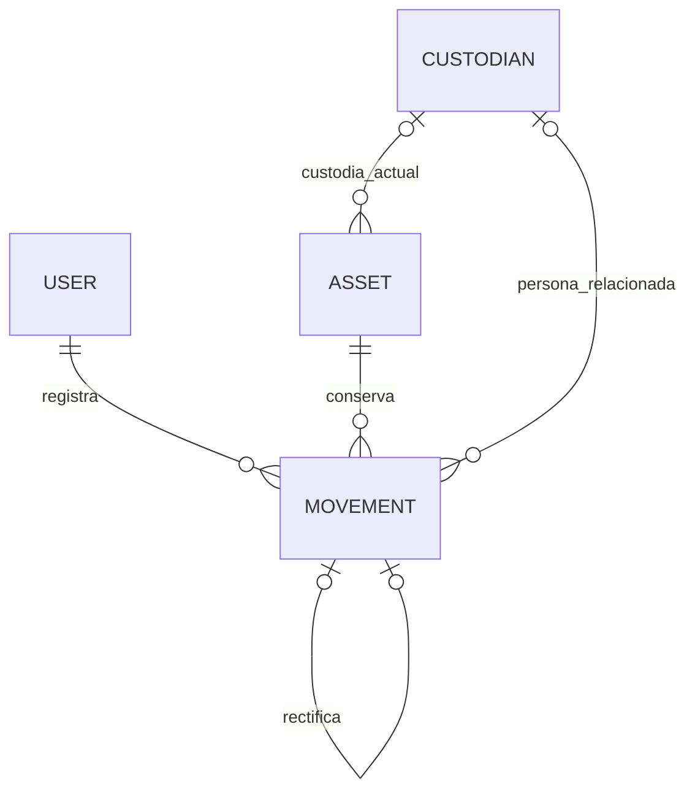

# Modelo de datos: activos y custodia

**Base:** [spec.md](spec.md). **Diseño:** [plan.md](plan.md). Nombres en inglés corresponden a implementación; etiquetas visibles y valores funcionales se muestran en español.

## Entidades y cardinalidades

User es el modelo existente de Django. Grupo Gestores identifica la autorización; la persona custodio no tiene relación obligatoria con User ni cuenta de acceso. Un gestor puede operar sobre cualquier activo. Un custodio puede tener varios activos; un activo tiene cero o un custodio actual.

## Asset

| Campo | Tipo previsto | Validación / origen |
|---|---|---|
| id | BigAutoField | Identificador interno, no editable. |
| code | texto único, hasta 32 | Servidor: secuencia NO CYCLE → TI- + mínimo seis dígitos; estable. |
| name | texto, 160 | Obligatorio, no vacío tras limpiar exteriores. |
| description | texto, 2000 | Obligatorio y separado del nombre. |
| category | enum | computadora_escritorio, portatil, monitor, impresora, equipo_red, periferico. |
| brand / model | texto, 120 cada uno | Obligatorios; sin catálogo administrable. |
| serial_number | texto, 160 | Obligatorio; conservar caracteres interiores. |
| location | texto, 240 | Obligatoria, lugar actual informado. |
| condition | enum | operativo, averiado, en_reparacion; obligatorio al alta. |
| assignment | enum | disponible, asignado; servidor fija disponible al alta. |
| current_custodian | FK Custodian nullable, PROTECT | Nulo si Disponible; obligatorio si Asignado. |
| revision | entero no negativo | Inicial 0; aumenta con cada operación aceptada, incluida rectificación. |
| created_at | fecha/hora con zona | Generada por servidor. |
| created_by | FK User PROTECT | Gestor que registra el alta; no impuesto por el cliente. |

Los tamaños son límites técnicos iniciales de entrada, con errores claros; no cambian los campos obligatorios aprobados. La asignación es un dato obligatorio de la ficha, establecido por el sistema y no editable en el alta. No exponer una API de edición general o borrado.

Restricciones: code único; combinación Lower(Trim(brand)), Lower(Trim(model)), Lower(Trim(serial_number)) única. CHECK de valores enum y de equivalencia Disponible/sin custodio o Asignado/con custodio. Una operación debe mantener la ficha coherente con el evento en una misma transacción. La secuencia de códigos admite huecos técnicos y nunca se reinicia para año/categoría ni se recicla por corrección.

## Custodian

| Campo | Tipo previsto | Validación |
|---|---|---|
| id | BigAutoField | Interno. |
| full_name | texto, 160 | Obligatorio. |
| email | EmailField, 254 | Formato válido, obligatorio, sin whitelist de dominios. |
| department | texto, 160 | Opcional; dependencia. |

Correo único mediante Lower(Trim(email)); limpiar espacios exteriores. Nombre y correo identifican a la persona para selección e historial. No implementar editar/eliminar personas en este incremento; así no se alteran antecedentes mediante esos recorridos no aprobados.

## Movement

| Campo | Tipo previsto | Regla |
|---|---|---|
| id | BigAutoField | Orden de registro por activo; no confiar solo en timestamps iguales. |
| asset | FK Asset PROTECT | Obligatorio. |
| type | enum | entrega, devolucion, cambio_condicion, rectificacion. |
| occurred_at | fecha/hora con zona | Registro automático; sin fecha retroactiva aportada por cliente. |
| actor | FK User PROTECT | request.user validado como gestor. |
| actor_label | texto | Copia de la identificación del gestor al registrar para conservar lectura histórica. |
| custodian | FK Custodian nullable, PROTECT | Persona relacionada en entrega/devolución; nula en cambio de condición. |
| custodian_snapshot | JSON | Nombre/correo de la persona relacionada cuando corresponda. |
| before / after | JSON estructurado | condition, assignment, custodian_id, location. Se generan en servicio, no desde payload del cliente. |
| note | texto, 2000 | Observación opcional. |
| reason | texto, 2000 | Obligatorio para cambio_condicion y rectificacion; sin exigirlo para entrega/devolución. |
| rectifies | OneToOne Movement nullable, PROTECT | Obligatorio solo para rectificacion; original del mismo activo. |
| resulting_revision | entero | Revisión del activo tras la operación; única por activo. |

Conservar originales sin UPDATE/DELETE. No mantener un booleano editable `anulado` en el evento original: su rectificación se obtiene mediante la relación inversa. El movimiento original conserva su tipo; el nuevo evento tiene tipo rectificacion, vínculo y snapshots; el custodio relacionado corresponde al movimiento objetivo, mientras before/after reflejan el cambio realizado por la rectificación.

Checks y servicio: tipo permitido; vínculo rectifies si y solo si rectificación; razón no vacía cuando requerida; activo y autor obligatorios; objetivo pertenece al mismo activo. Las condiciones de orden/elegibilidad se comprueban después de bloquear Asset; el vínculo único evita doble rectificación. Las restricciones entre tablas que no expresa un CHECK se validan en el servicio y se prueban en PostgreSQL.

## Transiciones

| Operación | Precondición | Datos del gestor | Resultado |
|---|---|---|---|
| Alta | Datos válidos, combinación no repetida | Campos de activo y condición | Disponible, sin custodio, ubicación inicial, revisión 0. |
| Entrega | Disponible + Operativo | Custodio existente, destino, observación opcional, revisión vista | Asignado, custodio indicado, ubicación destino, evento y revisión +1. |
| Devolución | Asignado con entrega/custodia activa | Condición recibida, recepción, observación opcional, revisión vista | Disponible, sin custodio, condición recibida, recepción, evento y revisión +1. |
| Cambio de condición | Disponible y condición distinta | Nueva condición, motivo, observación opcional, revisión vista | Asignación/custodia/ubicación permanecen; condición cambia, evento y revisión +1. |
| Rectificación | Último evento es entrega/devolución/cambio vigente sin sucesores ni rectificación | Objetivo, motivo, observación opcional, revisión vista | Restaura snapshot anterior del objetivo; añade evento vinculado; revisión +1. |

La devolución relaciona a quien tenía la custodia antes de retirarla. No se acepta devolución sin entrega activa. No se rectifica una rectificación. Ejemplo A entrega → B devolución → R rectifica B: el activo vuelve a Asignado como antes de B, pero A no es rectificable porque conserva sucesores B y R. Una nueva operación C sí podrá ser rectificable si es la última y cumple la regla.

## Trazabilidad del diseño

Asset y unicidad: FR-002–FR-007, FR-015, FR-021. Custodian: FR-019. User/permiso y actor: FR-010–FR-011, FR-014. Movimientos y snapshots: FR-012–FR-018, FR-020, FR-022. Revisión, restricciones, bloqueo y atomicidad: FR-023. Consultas y contratos web/API: FR-001, FR-008–FR-009.
